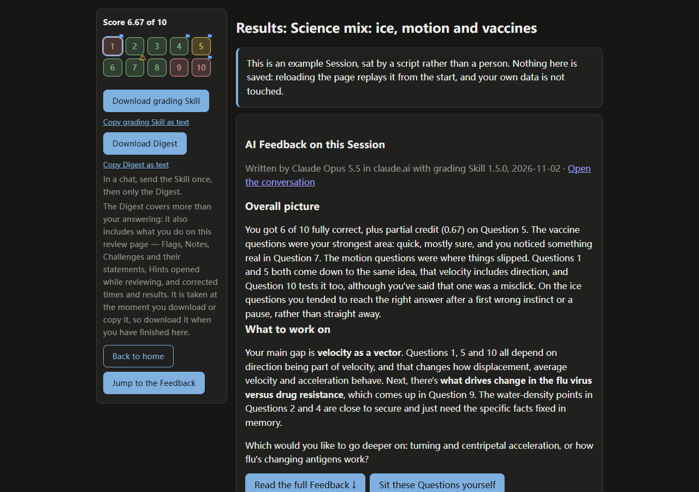
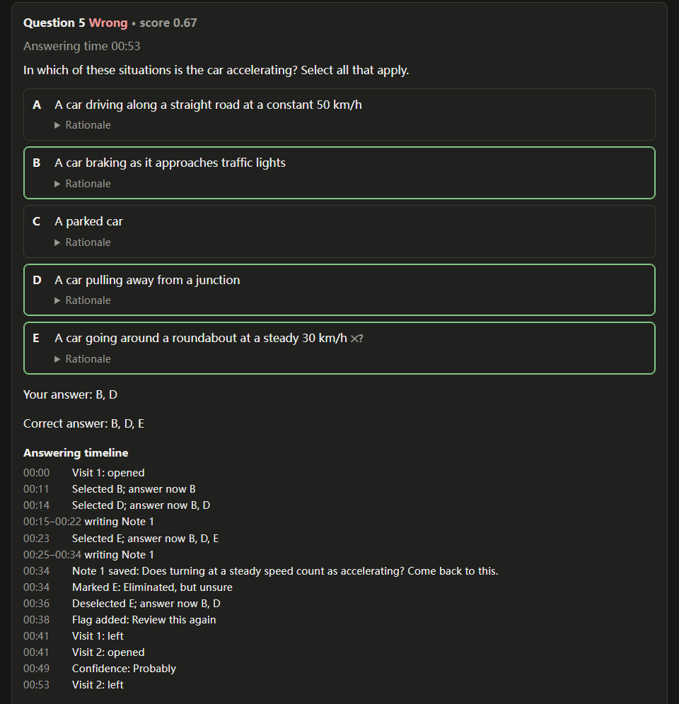
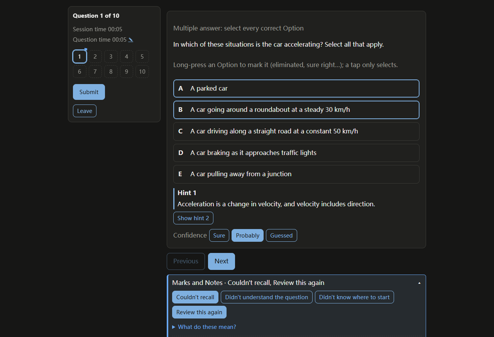

# PencilMark

Ordinary quiz tools keep one thing about each question: right or wrong. PencilMark keeps how each Question was answered: where you hesitated, which Options you eliminated, how often you changed your answer, which Hints you opened, how sure you were, what you wrote in a Note. It hands an AI that record, the Digest, so its Feedback can aim at where your reasoning wavered, not only at what was wrong.

**Live demo: <https://hmaevan.github.io/pencilmark/>.** Everything runs in the browser, with no server and no account. The quickest look is the Showcases below: ready-made example Sessions you can open from Home (**See the example**) without importing anything.

## Showcases

A Showcase is a Question pack, a scripted Session sat on it, the Digest that Session produces, and an AI's Feedback on that Digest. Opening one replays the script in memory and shows its Showcase page; nothing is saved. The Showcase page leads with a card of the Feedback, and **Sit these Questions yourself** opens the usual import preview of the Showcase's Question pack.

| Showcase | Language | Live page | Question pack | Fact-check report | Feedback conversation | Grading Skill | Date | App version |
| --- | --- | --- | --- | --- | --- | --- | --- | --- |
| General science | English | [open](https://hmaevan.github.io/pencilmark/#/showcase/general-science) | [`samples/general-science.json`](samples/general-science.json) | [`fact-check.md`](showcases/general-science/fact-check.md) | [Claude Opus 5.5 in claude.ai](https://claude.ai/share/d6569f86-0775-4180-8cd5-bcf644eca653) | 1.7.0 | 2026-11-02 | 0.2.0 |

## What it looks like

A Showcase page: the AI's Feedback first, and beside the question list the downloads for the Digest and the grading Skill.



A Question on the Review page with its Answering timeline: selections and deselections, an Item flag, and a Note written in two stretches around an answer change, each at the time it happened.



The Answering page mid-Question: a Hint open, a Confidence set, and the Flags offered while answering.



## How it works

1. Press **Download question-writing Skill** and attach the file to any AI chat with your study material (or paste its text with **Copy question-writing Skill as text**). To let the AI reuse your existing Tracks and Topics, also paste the result of **Copy my Tracks and Topics**. Then paste the AI's reply (a **Question pack**, JSON) into the import box and press **Check and preview**.
2. Confirm the preview and the pack becomes a **Set** on Home. Press **Start** to sit a **Session**.
3. Submit, review your answers, and press **Download grading Skill** and **Download Digest** and attach the files to an AI chat. In a chat that already has the Skill, send only the Digest. Beside each download is a link to copy the same text instead (**Copy grading Skill as text**, **Copy Digest as text**). Where the AI can create files, it returns a Question pack as a `.json` file that you import with **Choose file**.

To try it without any material, press **Import the sample Set** on an empty Home.

The two Skills are self-contained, work in any AI chat, and work in Claude as skills:

- [`skills/pencilmark-question-writing/SKILL.md`](skills/pencilmark-question-writing/SKILL.md): the Question pack format, with a complete example.
- [`skills/pencilmark-grading/SKILL.md`](skills/pencilmark-grading/SKILL.md): how to read a Digest and teach from it.

Each Skill is a folder holding a `SKILL.md`, the standard Agent Skills layout. To install one in Claude, add its folder (such as `skills/pencilmark-grading/`) as a skill. Each carries a `metadata.version` in its frontmatter, raised whenever its text changes in a way a reader would notice.

Sample Question packs are in [`samples/`](samples/); the file formats and the database are documented in [`schema/`](schema/README.md).

> Work in progress. The interface is in Chinese and English, following the browser language; switch it at the top right of Home or at the bottom of the other pages.

## Architecture

```
Raw log ──Derivation──▶ Attempts, Answering timelines ──▶ Digest ──▶ AI's Feedback
append-only,            kept per Derivation,              for the AI
hash-chained            re-derivable
```

- **Raw log.** Everything the user does in a Session is recorded as time-ordered events and never edited ([ADR-0001](docs/adr/0001-raw-log-append-only.md)). Typing in a Note is recorded change by change ([ADR-0010](docs/adr/0010-typing-recorded-change-by-change.md)).
- **Derivation.** Attempts, answering times, Answering timelines and the Digest are computed from the Raw log, so a rule can change and be re-derived without touching what happened ([ADR-0002](docs/adr/0002-derived-data-kept-per-derivation.md)). User corrections are Overrides, kept beside the derived value.
- **Hash chain.** Each sealed Raw log chunk carries a hash of itself and of the chunk before it. Sealed chunks are never written again, and a broken chain is reported when the Session is opened. Hashing is used nowhere else.
- **Storage adapters.** One storage interface with adapters for IndexedDB (Local mode), the Artifact database (Artifact mode) and memory (tests and Showcases), in [`src/storage/`](src/storage/). There is no server of our own ([ADR-0006](docs/adr/0006-no-self-hosted-server.md)).
- **Tests at three seams**, written test-first: Derivation, the Importer and the Recorder. The interface has no automated tests; each change to it ends with manual acceptance steps run in the app.

Domain terms are defined in [`GLOSSARY.md`](GLOSSARY.md); every design decision is in [`docs/adr/`](docs/adr/).

## How this was built

Built with AI coding agents (Claude Code) under my direction. Each feature began as a grilling session: using the `grill-with-docs` and `domain-modeling` skills from Matt Pocock's open-source [skills](https://github.com/mattpocock/skills), an agent questioned me about the design until every open decision was settled, and by me. It then wrote the result down — the [spec](https://github.com/HMAEvan/pencilmark/issues/1), GitHub issues, glossary entries and decision records — and I confirmed each one before it was saved. Implementation agents then took one issue at a time, test-first at the agreed seams; a supervising agent reviewed and merged each change, and I checked the result in the running app.

The working rules are in [`CLAUDE.md`](CLAUDE.md); changes are listed in [`CHANGELOG.md`](CHANGELOG.md).

## Security design

PencilMark treats everything an AI writes, and every file it imports, as untrusted input.

- **AI-generated text is never trusted as HTML.** Question content is rendered as Markdown with LaTeX maths, with raw HTML switched off: a `<script>` or `` in a pack is shown as text, and Markdown images are not loaded. All generated HTML (the Markdown output and KaTeX's) then passes one sanitiser, [`src/render/sanitise.ts`](src/render/sanitise.ts), before it reaches the page, and KaTeX runs without `trust`. The Digest and the Answer pack carry the source text unrendered.
- **Imports are validated before anything is written.** A Question pack is parsed as JSON and validated against [its JSON Schema](schema/question-pack.schema.json), which rejects unknown fields, and then against the rules a schema cannot express (answers naming real Options, unique labels, the true/false convention). Errors are located by Question and field. A valid pack is shown as a preview first, and new Tracks and Topics are created only once you confirm them. The pack's own labels are never used as IDs: the tool assigns its own. Nothing is imported automatically, the sample Set included.
- **The Raw log cannot be quietly rewritten.** Sealed chunks are never written again, and each carries a hash of itself and of the chunk before it, so corruption or tampering is reported when the Session is opened. This detects accidents and casual edits; it is not a signature.
- **Your data and keys stay yours.** There is no PencilMark server ([ADR-0006](docs/adr/0006-no-self-hosted-server.md)); data lives in your browser's IndexedDB, or, in Artifact mode, in your private part of the Artifact's database, which nobody else can read, the Artifact's owner included. The current version uses no API keys: you copy text to and from AI chats yourself. When an API mode arrives, a key you enter will be stored only on your device and sent only to the AI provider it belongs to.

## Development

Requires Node.js 24.

```bash
npm install
npm run dev        # http://localhost:5173/pencilmark/
npm test           # Vitest
npm run typecheck
npm run build      # single self-contained dist/index.html
```

## Artifact mode

The same build runs as a claude.ai Artifact. Inside claude.ai it stores everything in the Artifact's database, under your private path (`data/users/<your id>/pencilmark/…`), so a Session's Raw log, derivations and Attempts survive a reload and appear on any device where you open the Artifact. Opened anywhere else, it uses IndexedDB as before. If it is opened inside claude.ai but the database is unavailable (signed out, or the permission not granted), it says so at the top of the page and keeps the data in that browser only.

To publish, or to release a new version:

1. `npm run build`.
2. Publish `dist/index.html` as an Artifact with the capabilities `{ "db": {}, "user": {} }`. From Claude Code: ask Claude to publish `dist/index.html` as an Artifact with those capabilities.
3. On later releases, update the **same Artifact URL** (publish to it again) rather than creating a new Artifact: the database belongs to the Artifact, so a new Artifact starts empty.

Each copy has its own data: the GitHub Pages copy and the Artifact do not share anything. Moving data between them needs Backup ([#13](https://github.com/HMAEvan/pencilmark/issues/13)), which does not exist yet.

## Licence

[MIT](LICENSE)
